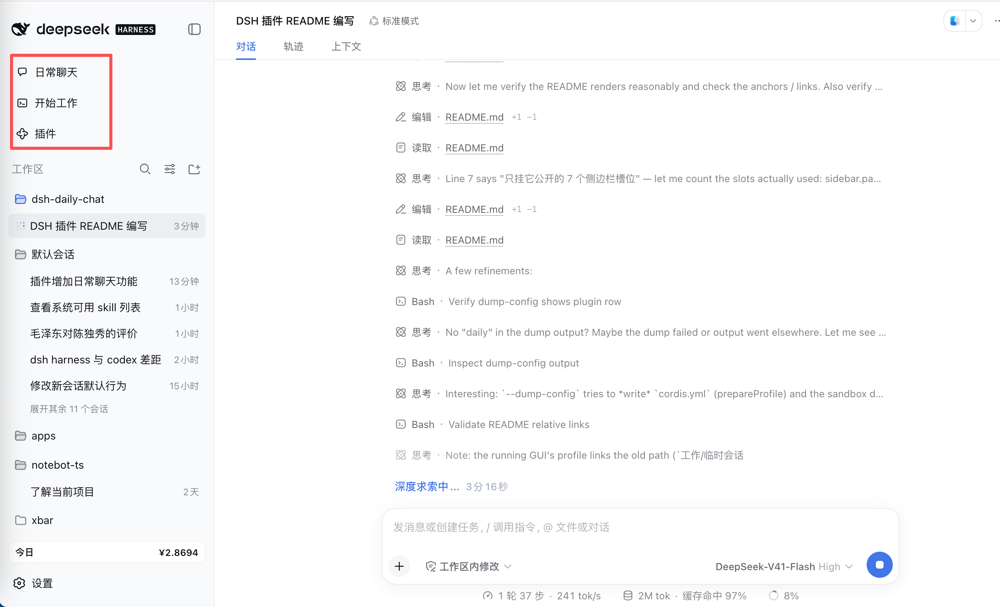

# dsh-daily-chat

> 给 DSH（DeepSeek Harness）的「新会话」加上第二重含义：**日常聊天** 与 **开始工作**。
>
> 日常模式跑一个以对话为主的轻量 agent —— 有人格、能联网检索、能向你提问、能读写本地文件、能压缩上下文，但没有 Shell、没有计划模式、没有子代理；工作模式完全沿用 DSH 原有行为，唯一多出来的东西是每轮回答页脚上那行耗时（就在「用量 / 时刻」那一行里，见[使用](#使用)与[已知限制](#已知限制)）。

一个纯客户端 DSH 插件：不 fork DSH 本体，只往它公开的 8 个槽位注册 15 条内容、再加三个方法补丁（客户端两个导航方法、Host 一个预设选择），DSH 升级后不会把插件带坏。面板列表本身不接管；唯一的重排是把系统那两行「插件」「自动化任务」收进 DSH 自带的「更多」，并且让「更多」在原处向下展开、再点收起 —— 不弹二级菜单；两个面板本身不动。

<div align="center">
  
  <br />
  <sub>侧边栏顶部多出「日常聊天」「开始工作」两行，原生「新会话」按钮被隐藏；日常模式下工作区区域会换成日常会话列表</sub>
</div>

## 📑 目录

- [它解决什么问题](#它解决什么问题)
- [两种模式](#两种模式)
- [安装](#安装)
- [使用](#使用)
- [工作原理](#工作原理)
- [配置项](#配置项)
- [目录结构](#目录结构)
- [开发](#开发)
- [已知限制](#已知限制)
- [卸载](#卸载)
- [License](#license)

## 它解决什么问题

DSH 原本只有一个「新会话」，而它一定是完整的编码 Agent：带着工作目录、bash、文件读写、计划模式、子代理。用它来问一句「今天天气怎么样」或者闲聊两句，代价是模型手里攥着一整套会往仓库里动手的工具，提示词里也全是工程上下文 —— 答话的语气和边界都被带偏。

这个插件把入口拆成两个，像 ChatGPT 把 chat 和 work 分开那样：

日常不是「阉割到只能说话」：文件读写留着，因为聊天里十有八九要落到某个具体文件上；去掉的是 bash、后台作业、计划模式、待办与子代理这些会自己推进一个工程的能力 —— 边界是「能帮你改这一份文件」，不是「能接管这个仓库」。

| | 日常 | 工作 |
|---|---|---|
| 你点的是 | 侧边栏「日常聊天」 | 侧边栏「开始工作」，或其它任何「新会话」入口 |
| 跑的是哪个 agent | `daily` 预设 | profile 默认预设（默认 `standard`） |
| 模型手里的工具 | 对话人格、网页检索/抓取、提问、本地文件读写（`read` / `read_image` / `write` / `edit` / `glob` / `grep`）、上下文压缩 | 全部 |
| 侧边栏那一片 | 换成日常会话列表 | 原生工作区浏览器，且不出现「日常聊天」这一行 |
| 上下文 | 锁死：改不了项目，也换不了 Agent 模式 | 随便改 |
| 会话落在哪 | 专属工作区（标题「日常聊天」） | 原有工作区 |
| 记忆 / 图片识别 / 模型路由 | 照常可用 | 照常可用 |

「日常」是一块真实的工作区而不是一个 UI 开关，所以日常对话是正常 Session：历史留得住，列表就是记账到该工作区的会话。

## 两种模式

| | 日常 | 工作 |
|---|---|---|
| 侧边栏入口 | 「日常聊天」整行，`order: -20` | 「开始工作」整行，`order: -10` |
| 面板列表的「更多」 | DSH 自己那一行；点开后直接在列表里向下展开（行下长出来，再点收起），不弹二级菜单；「插件」「自动化任务」两行不在列表里，改成展开后的前两行 | 同左 |
| 预设 | `daily` | profile 默认（本机为 `standard`） |
| 开场那一行 | 「项目」与「Agent 模式」两个 chip 都不出现 | 两个都在 |
| 能不能改上下文 | 不能：会话钉在「日常聊天」工作区上，预设钉在 `daily` 上 | 随便：项目、预设、计划模式、子代理 |
| 核心循环 | 用户消息 → 模型 → 工具调用（检索 / 提问 / 读写文件）→ 回复 | 用户消息 → 模型 → 工具调用（读文件 / 改文件 / 跑命令 / 计划 / 子代理）→ 回复 |
| 会话列表 | 日常会话：置顶组排在最前、两组各自按最近更新排；行悬停/聚焦时右端时间格换成「归档会话 / 置顶会话」两个动作，置顶行时间后带图钉；已归档默认隐藏，表头「视图选项」切「隐藏 / 全部 / 仅显示」三档；运行中带绿点；默认只画前 20 行，滚到列表底部再补 20 行 | 原生分组列表 |
| 侧边栏的工作区 | 原生工作区列表整体让位给日常会话列表 | 原生列表，但**不出现**「日常聊天」这一行 |

两行都排在「插件」之上（该行 `order: 0`，槽位按 `priority`、`order` 升序排）。原生侧边栏的「新会话」按钮会被隐藏，由「日常聊天」「开始工作」这两行取代；macOS 窗口控件等其它「新会话」入口仍然在，并按当前模式路由。

两个模式是互斥的视图，不只是换个预设：工作模式下侧边栏不列「日常聊天」—— 它不是项目，而且点一下整行就会把产品切回日常；日常模式下原生工作区列表整体让位给日常会话列表。

## 安装

### 0. 前置条件

- 一个可运行的 DSH web profile，**版本 ≥ `0.1.7`**。本版本在 DSH `0.1.7-alpha.2`、macOS 上验证过；依赖的槽位契约是 `sidebar.panellist` / `sidebar.workspaces` / `shell.overlay` / `main` / `conversation.chat.turnTail` / `conversation.chat.assistant-actions`。0.1.6 及更早从用户预设根读目录（见第 1 步），本版不再往那里写任何东西。后两个槽位都是给那行耗时用的，且互相兜底：只有 `turnTail` 时那行落在动作行下面，只有 `assistant-actions` 时不画（没有数字可读），两个都在才落进动作行、跟在时刻右边。老 DSH 上注入不进来的席位只是那行不出现，其余功能不受影响。
- 插件分两半：Host 半（[index.js](./index.js)）建工作区、锁日常会话的预设、提示老安装残留的预设目录；`daily` 预设由包内 patch 声明（见第 1 步）；客户端半（[client.js](./client.js)，`dsh.client.platform: web`）贡献全部界面。没有构建步骤。

### 1. `daily` agent 预设：随插件一起声明

日常模式跑的 `daily` 预设随包发布在 [preset/daily.patch.yml](./preset/daily.patch.yml)：一行 `@deepseek-ai/dsh-agent-preset` 声明，`config.plugins` 决定这个预设装哪些行（人格、网页工具、文件工具、提问工具、压缩组），`config.name` / `config.description` 是选择器里的显示名与描述，`config.order: 5` 让它排在 harness 自带的四个预设（`standard` / `ptc` / `minimal` / `cordis`）之后。

DSH `0.1.7` 起，预设就是这种「由 bundle patch 带进来的 declaration row」，不再从 `<dshHome>/.agent-presets/<presetId>/` 读任何东西。所以本包把这份 patch 也列进 `dsh.bundle.patch`：**装上插件就装上了预设** —— 没有目录要复制，没有用户预设根要写，也没有「已存在就不覆盖」的规则。你在设置页里改过的预设，DSH 会按行 id `preset-daily` 覆盖到 profile 的 `cordis.patch.yml`（用户层，永远压过包内这一份）。

> 从 `0.1.6` 或更早的版本升上来：那些版本由 Host 半把 `preset/daily/` 复制到 `~/.dsh/.agent-presets/daily/`。这条老路在新 DSH 上已被完全忽略，旧目录留着不会有任何作用（插件每次启动会在控制台提醒一次），可以直接删掉。
>
> 没有这个预设也能跑起来：插件选预设失败时只打一条 warn 并回退到 profile 默认预设，代价是日常会话又变回完整编码 Agent —— 日常模式就失去意义了。这条回退只在两件事同时成立时触发：这次创建失败的原因正是「`daily` 解析不出来」（`agent-preset/not-found` / `agent-preset/invalid`；别的失败一律原样上报，不重试），且工作区里没有可复用的空白会话 —— DSH 复用空白会话时按请求点名的预设重新组合它，而点名给非 `daily` 正是 Host 半那条锁拒绝的目标（见[工作原理](#工作原理)），所以已经有空白会话时宁可让这一次点击报错。

### 2. 把插件装进 profile

插件是 `private` 的本地包（包名 `@local/dsh-daily-chat`，不会发布到 npm），用链接方式装进某个 profile。

**方式 A：Web 侧边栏「插件」页** —— 安装组合包，填本仓库目录的绝对路径。管理器会读该目录的 `package.json`，确认它声明了 bundle patch，装好后默认启用。

**方式 B：命令行**

```bash
dsh plugin --profile web add link:/path/to/dsh-daily-chat
```

然后确认 profile manifest `~/.dsh/profiles/web/package.json` 的 `dsh.profile.bundles` 里包含了 `@local/dsh-daily-chat`，没有就手动加在列表末尾 —— bundles 是插件挂载顺序，放最后即可：

```json
"bundles": [
  "@deepseek-ai/dsh-base",
  "@deepseek-ai/dsh-web-app",
  "@local/dsh-daily-chat"
]
```

### 3. 生效

重启 `dsh web`，刷新页面。部署里启用了 HMR 的话配置改动会自己生效，否则运行中的组合会保留到重启。侧边栏面板列表顶部会多出「日常聊天」「开始工作」两行；「插件」「自动化任务」会从列表收进 DSH 自带的「更多」，点「更多」它会在原处向下展开那几行（再点收起），而不是弹出二级菜单；其余面板行保持原生行为（见[文首截图](./assets/sidebar-modes.png)）。原生「新会话」按钮同时消失。

装好后开一个**新会话**验证：点「日常聊天」应该直接落在一个空白会话的输入框里，且该会话有 `read` / `write` / `edit` / `glob` / `grep`，没有 bash。

## 使用

- **点「日常聊天」** —— 解析（必要时创建）日常工作区 → 打开一个空白会话（这次创建请求里直接点名 `daily`：建出来的空白会话直接跑 `daily`，复用到的也不会被重新组合回部署默认预设）→ 把中间栏交还会话。中间只会闪一帧占位文字，不会停在中间页；同一个入口连点两次走的就是这条复用路径，不会再报错。
- **点「开始工作」** —— 记下工作模式，走 DSH 原生的 `startSession`。
- **「插件」「自动化任务」收在「更多」里，点「更多」向下展开** —— 侧边栏面板列表不再画这两行，点 DSH 自己那一行「更多」，它先把自己写成**「收起」**，然后把那几行直接在行下方长出来：行高、字号、图标和悬停底色都对齐上面那几行，会话列表整体往下让；再点「收起」合上、字回到「更多」、列表回来 —— 不是弹一个二级菜单，也没有浮层。展开后最上面是「插件」和「自动化任务」，点开的是原来那个面板（插件管理页 / 自动化任务页）；下面 DSH 自带的「浏览更多插件」「创建你的插件」原样保留。标签和图标都是从系统台账里读回来的（就是原来那两行画的 pinwheel / 时钟），所以和原来的行是同一套本地化文案与图形；菜单内容挂不上时（旧 DSH 没有 `sidebar.panellist.actions` 席位、或 primitives 里没有 `MenuItemButton`）插件不会藏那两行，行为退回原生。点展开区里的一行、点侧栏别处或按 `Esc` 都会收起；侧栏收成图标轨道（没有宽度可展开）时仍然弹原生菜单，那一行也保持「更多」。
- **对话页视图标签行那个「更多」（省略号）该没有就没有** —— 标题下面那排「对话 / 轨迹 / 上下文 …」右侧的省略号，本来会挂两行「浏览更多插件」「创建你的插件」（DSH 自带的 entry-customization 插件往这个菜单位置注册的）。这两行被本插件摘掉；而如果视图标签全都塞得下、没有任何视图被折叠进这个菜单，那它里面就是空的，**省略号从一开始就不显示**（不用点一下才知道），算的是 DSH 自己那条：`floor((标签行宽 − 48) / 120)` 个可见标签，和注册的视图数量比。窗口变窄、或视图多到被折叠时，省略号自己回来，点开只有被折叠的视图、没有那两行插件推广；窗口放宽、视图又都露出来之后，省略号再自动收掉。侧边栏那个「更多」不受影响。
- **日常里能读写本地文件** —— `daily` 预设挂了 `tool-fs` 与 `tool-fs-search`，模型直接持有 `read` / `read_image` / `write` / `edit` / `glob` / `grep`，不用再让你把文件内容复制粘贴进对话。沙箱后端与「改前必读」策略仍然是宿主层那一套，和 `standard` 一模一样：读取不受工作区限制；写入/编辑默认只允许落在会话工作区（日常就是 `~/.dsh/daily-chat`）和系统临时目录里，要改别处得把该会话的权限模式切到 `danger-full-access`（或走 DSH 的升权授权）。它仍然没有 bash、后台作业、技能、目标、计划模式、待办、子代理与 workflow —— 文件读写是「能帮你改这一份文件」，不是「接管这个仓库」。
- **刚点开的新会话不会先在侧边栏里占一行** —— 点「日常聊天」「开始工作」，或别的任何「新会话」入口之后，DSH 侧边栏树里那条当前空会话（标题是本地化的「新会话」、没有时间戳）在第一条消息被接受之前不画；`blank` 标记在 prompt 被接受时清掉（被拒的 prompt 不算），下一次渲染它自己就变成一行普通会话 —— 真实标题、时间戳、行操作都回来。这条只改画出来的东西，会话本身、输入框、主栏都不受影响，所以点开又没说话不会在列表里留下一条空记录。日常模式其实用不上它：日常会话列表本来就不画 `blank` 会话（`dailyRows` 里 `row.blank === true` 直接跳过），所以它实际管的是工作模式那套原生工作区浏览器 —— 那里 `startSession` 一开，空白会话从点击那一刻就挂在树上。
- **工作模式里不出现「日常聊天」这一行，它的会话也不出现** —— 侧边栏的工作区列表读的是同一个模型，插件在工作模式下把日常工作区从那份快照里投影掉：宿主侧的注册、会话日志、目录都原样保留，只是这个前端不画它。光藏那一行不够 —— 浏览器的「未分组」是拿「会话列表 − 可见工作区的记账」算出来的，藏了行那些会话会整批掉进「未分组」，所以工作模式下属于日常目录的会话也从会话列表里一并去掉（按工作区记账和按会话 `cwd` 两条判据都算，后者是宿主半锁预设用的同一条规则）。顺带修掉一个岔路 —— 原生「新会话」会按「当前会话所属的工作区」挑目标，在日常聊天里点「开始工作」时那个当前会话正属于日常，于是新会话又被开进日常聊天；现在这一步已经看不见那个工作区了，目标落到最近用过的**工作**项目上，一个工作项目都没有时中间栏回到空白首页。
- **日常里改不了上下文** —— 日常聊天只有「日常聊天 / `daily`」这一种上下文，所以开场那行的「项目」和「Agent 模式」两个 chip 直接不出现；从别处发起的工作区切换（空会话里那个「选工作区」提示、目录选择器）会被服务层拒绝并弹一张提示卡，从设置页把某个预设「设为默认」也改不动日常会话的预设，只会看到 DSH 原生的「无法切换到…」。想换项目或换能力，先点「开始工作」。
- **模式会记住** —— 存在 localStorage 的 `dsh.daily-chat.mode`，读写失败时一律按 `work` 处理，不改变原有习惯。
- **日常列表** —— 日常模式下，侧边栏工作区区域被替换成日常会话列表，这整块（分区标题 + 「视图选项」按钮 + 加号按钮）照抄工作模式那一块：36px 行高、`margin` 与左内边距一致，标签不再自带字号字距，直接继承侧栏的 14px 与分区标题的三级字色，`max-width:45%` 保证挤不到按钮；按钮优先取 primitives 的老名字 `IconProjectAddOutline16`（工作模式同一个），没有就用当前 primitives 实际导出的 `IconProjectAddOutlineRegular` —— DSH 0.2.x 上不再退化成纯文本「＋」，两个都没有才退回「＋」；同一套 28px 圆角方形 hover 样式（`--dsw-radius-sm`，不是圆）、同一套右边距 —— 只靠 `--dsh-sidebar-inline-padding` 内缩，右边缘与侧栏内容框齐平（工作模式那条 `margin-right:-4px` 在这版 DSH 里实测没生效，所以这里按实测而不是按那行声明对齐），展开时 16px、收起时 18px。列表本体的滚动几何也照抄工作模式那一套：外面再套一层 `listArea`，用 `margin-right:calc(-1 * 内缩)` 把列表整个拉回**侧栏外缘**，列表自己再 `margin-right:2px` + `scrollbar-gutter:stable` + `padding-right:calc(内缩 − 滚动条 8px − 2px)`。隔着一张对照截图量出来的结果是：滚动条右缘落在侧栏外缘内 **2px**（工作模式实测 2px，改之前我们是 14px），行的右缘落在内容框边缘（两边都是外缘内 12px），而且列表会不会滚动都不会左右抖。点一行打开该会话并确保仍处于日常模式（已归档的行不打开，见下）；行本身从 `<button>` 改成 `<div role="treeitem" tabindex="0">` —— 下面要挂两个动作按钮，交互元素不能嵌套在 `<button>` 里 —— Enter/Space 打开，当前打开的那一行用和工作模式一样的 hover 底色常驻（`aria-selected`）。行里是状态点、标题和右端那格相对时间 —— 标题照抄工作模式会话行的 `.title`：14px/20px，同一列里两边的会话名是同一个字号（这也意味着整列不用再为它单独压字号，之前试过的「整列 13px」已经撤掉了）；整行高度也照旧是 32px —— 那边是定高 32px，这边是 20px 的行盒加上下各 6px 内边距，所以换字号没有把行高顶起来。那格照抄工作模式会话行的时间戳：`flex:none` 的 10px/16px、三级字色，不抢标题宽度（标题照旧 `flex:1` + 省略号，挤不下先截标题，不截时间）。文案也走工作区浏览器同一套阈值：不到一分钟是「刚刚」，不到一小时是「N分钟」，不到一天是「N小时」，不到 30 天是「N天」，不到一年是「N个月」，再往上是「N年」（英文 `now` / `5min` / `3h` / `22d` / `2mo` / `1y`），并且**不**加「前」—— 它是标题旁边的一格，不是一句话。那格平时是「相对时间 +（置顶时）14px 实心图钉」，悬停、或键盘焦点（且只有 `html[data-input-modality="keyboard"]` 时的 `focus-within`）才让位给动作，规则和工作区会话行逐条相同：`@media (hover:hover)` 下把右端那格换成两个 24px 裸图标按钮（13px 间距、−4px 光学边距），顺序也是先「归档会话」后「置顶会话」；触屏（`@media (hover:none)`）没有悬停可等，两个按钮常显、时间格直接让位。这里最容易踩的一处：鼠标点完「置顶会话」之后焦点仍留在那个按钮里，如果把 `focus-within` 无差别算成「悬停」，置顶行会一直显示归档/置顶按钮、时间格回不来；所以和 DSH 原生一样只在键盘模态下认焦点 —— 鼠标移开，行就回到「时间 + 图钉」，归档按钮重新收起，再扫过才出现。置顶后这一行排到列表最前（置顶组、普通组各自按最近更新排），时间后面 6px 处多一枚 14px 实心图钉（16px 格、caption 字色、`aria-label="已置顶"`）；再点「取消置顶」回到普通排序。置顶 / 归档状态读的是工作区快照里的 `pinnedSessionIds` / `archivedSessionIds`（Host 全局的那一份），所以刷新页面、切模式都还在，日常里置顶的会话在工作模式的手动排序里也会被前置（`uiWorkspace.pinSession` 的内部行为）。归档走 `uiWorkspace.archiveSession`：点「归档会话」后这一行默认从列表消失，顶部居中弹 DSH 原生的 Toast ——「会话已归档，可 [撤销] 或 [筛选已归档会话]」，两个动作是行内按钮（撤销 = 取消归档，筛选已归档会话 = 切到显示已归档），success 勾图标，约 6 秒后自动消失；归档、置顶、取消置顶、取消归档失败各弹对应的 warning Toast。已归档的展示由表头「视图选项」按钮控制 —— 28px 圆角方形图标按钮（`--dsw-radius-sm`）、和工作模式同款 sliders 图标 —— 菜单是「筛选会话」标题加三档：隐藏已归档 / 全部对话（显示已归档）/ 仅显示已归档，和 DSH 工作区浏览器的同名选项同一套语义；选择持久化在 localStorage `dsh.daily-chat.archived-filter`（`default` / `show` / `only`，读不到按 `default`）。已归档行标题降到 caption 字色、状态点变暗、仍显示相对时间，悬停只出现「取消归档」；点它不打开会话，弹「已归档对话暂时无法查看，请取消归档后查看」；「仅显示已归档」且一条都没有时，列表中间显示归档图标 +「暂无已归档会话」+「查看其他会话」（点回 `default`）。运行中的会话归档会被 Host 以 `workspace/session-active` 拒绝，这时不弹失败、改弹「停止并归档此会话？」确认框（描述 + 将被停止的工作列表 + 取消 / 停止并归档），确认后调 `archiveSession(id, { stopActivity: true })`，成功弹「已停止并归档，可 [撤销] 或 [筛选已归档会话]」原生 Toast，失败留在对话框里显示原因。悬停时那层高亮也照抄工作模式会话行：同一个 `--dsw-alias-interactive-bg-hover` 半透明墨色、同一个 `--dsw-radius-md`（12px）圆角 —— 之前那版是实色 `bg-layer-2` 加 8px 圆角，和旁边那行不是同一个高亮。整列共用一个 30 秒的时钟：工作区树靠每次会话/工作区事件重渲染顺带刷新时间，日常列表可能几小时都不动，所以自己养了一个 timer；切到工作模式时这一区整个卸载，timer 跟着走。列表默认只画前 **20** 行（`ROW_PAGE`）—— 会话攒到几百条时，全量铺进 DOM 会拖慢侧栏滚动，也让那个 30 秒重渲染每次都带上全部行，而大多数时候人只看最近二十来条。末尾留一条 1px、`aria-hidden` 的 `.dsc-pager` 触发行，用 `IntersectionObserver` 盯着它（root 是列表自己、`rootMargin` 留 120px 提前量）：比自己写 `scroll` 事件少一层手算，也顺带管住「一页根本填不满视口」的情形 —— 触发行一露头就再放 20 行，窗口一段段往上加、**不重置已经滚到的位置**，全部放完就把触发行摘掉。窗口只在组件挂载期间增长：新会话插到顶上、标题改掉都不会把已经翻开的页收回去；切到工作模式再回来是整个组件重挂，重新从 20 行开始。视口特别高（两页还填不满）时 observer 会跟着每页重挂一次，一连补到列表真的能滚动为止 —— 否则会出现「只有两页、却滚不动、更旧的会话再也出不来」。没有 `IntersectionObserver` 的 webview 直接全量画，不会留下一段永远打不开的行。注意这只是渲染窗口：会话快照本来就整份交到前端，没有新增任何加载请求。那个加号等同于点「日常聊天」。
- **收起侧栏，这一区整个让位** —— 点侧栏顶部那个收起图标之后，工作模式的分区标签和会话列表都不再渲染（标签只在展开时给，列表整个不出现）。日常这边更进一步：轨道态把**整块表头（标签 + 视图选项 + 加号）和会话列表一起藏掉**，日常那一区什么都不画。理由有两条 —— 轨道的内容宽度只有 ~36px，列表挤进去只会糊成一团；而留着那个加号的话，它的中心在实测里比上方那排模式图标偏左 4px（图标列中心 28.75px，加号在 24.75px），与其为它单独对齐，不如让轨道回到「只用来切模式」的样子。再点一次展开，标题和列表都回来。
- **日常会话标题栏不带模式图标** —— 会话一开始，标题栏那个 Agent 预设胶囊只留「日常聊天」四个字，前面的小图标去掉：那个图标的意思是「这个会话跑在哪个 agent 模式下」，日常里这个答案永远是同一个，留着只是噪音。工作模式下照旧带图标。
- **每轮回答的页脚上多一行耗时** —— 一轮结束（`turn/end`）后，在这条回答页脚里「用量 1.1M tok / 07:35」那一行的最右端（时刻右边）多出 `用时 12秒`。数字就是这一轮从开始到结束的墙钟时长，单位按 DSH 自己的规矩凑：满一分钟才出现「分」，满一小时才出现「小时」，秒永远出现，所以是 `45秒` / `1分30秒` / `1小时1分1秒`，英文是 `45s` / `1m 30s` / `1h 1m 1s`。鼠标悬停能看到这一轮起止两端的绝对时刻（按本机时区格式化）。被中断或出错的一轮照样显示，只是标签换成 `已中断，用时` / `已出错，用时`（见[已知限制](#已知限制)）；两种模式都有这一行。
- **点击串台保护** —— 一次日常会话还没打开时又点了「开始工作」，以最后一次为准（内部用递增 ticket 作废过期的启动）。
- **失败会说话** —— 日常工作区准备不出来时会退回系统目录选择框让你手挑一个文件夹；仍然失败则在左下角弹一张提示卡，而不是静默什么都不发生。

## 工作原理

### Host 半 —— [index.js](./index.js)

做三件浏览器做不可靠的事：

1. **盯住 `daily` 预设的迁移。** 预设本身由包内 [preset/daily.patch.yml](./preset/daily.patch.yml) 声明（见[安装](#安装)第 1 步），Host 半只做一件事：如果发现某个老安装留下的 `<harness home>/.agent-presets/daily/`，就在控制台打一条提示，说明它已不再被读取、可以直接删（走 `console.warn` 而不是 `ctx.logger`：查过的部署里 logger 的输出没有接到服务端控制台，而这条提示的全部意义就是被人看见）。那个目录长得就像「预设已经装好了」，是排查「预设没了」时第一个该排除的东西。
2. **建并注册日常工作区。** 在 `<DSH_HOME>/daily-chat`（默认 `~/.dsh/daily-chat`）建目录，注册成标题为「日常聊天」的工作区；注册是幂等的，已注册的路径不动。
3. **把日常会话钉在 `daily` 预设上。** 在 `agentPresets.select` 的原型上补一层：会话的 `cwd` 是日常目录、而目标预设不是 `daily` 时直接拒绝，客户端会把它显示成 DSH 原生的「无法切换到「标准模式」：…」。这条只能落在 Host：客户端那半能藏掉 chip，但预设还有别的入口 —— 设置页的「设为默认」会顺手写进当前空白会话 —— 而预设决定模型手里到底有哪些工具。客户端因此把这个选择提前写进**创建请求**（`connectWorkspace` 的第二个参数）：DSH 复用工作区里那个空白会话时，是按请求点名的预设去组合它、不点名就按部署默认预设 —— 而那个默认正是这条锁拒绝的目标。不点名的话，连点两次「日常聊天」会在第二次拿到 `failed to create session: … 日常聊天固定使用 daily 预设…`：第一次已经把那个空白会话放到了 `daily`，第二次等于要求把它放回去。

三条都是尽力而为：第一条本来就只是提示，工作区那条失败也只打一条 warn，客户端会各自兜底（预设退回部署默认值，工作区退回目录选择框）；第三条在拿不到 `agentPresets` 时什么都不做，只是不锁。客户端那半用目录 basename `daily-chat` 认领工作区、按 id `daily` 选预设，所以浏览器永远不用猜路径、也不会一开始就弹框问人；`DSH_HOME` 的读法与部署其它部分一致，未设置时用 `~/.dsh`。

### Client 半 —— [client.js](./client.js)

八个槽位上的十六条注册、三个原型补丁、一个 store 补丁，外加一个 `<html>` 属性（Host 那半另有一个预设补丁，见上）：

| 席位 | 配置 | 作用 |
|---|---|---|
| `sidebar.panellist` ×2 | `order: -20` / `-10` | 两个带图标 + 文字的入口：「日常聊天」「开始工作」。行长得像「插件」，点击权归侧边栏，只能 `selectPanel(id)`。「插件」「自动化任务」两行由 DSH 自己注册，插件只把它们从列表里藏掉（下一行） |
| `sidebar.panellist.actions` ×1 | `order: -10`，菜单内容 | 「更多」展开后最上面的两行「插件」「自动化任务」：标签与图标从 `sidebar.panellist` 台账里按 id 读回来（和原行同一套本地化文案，glyph 就是各面板自己注册的那个图标），点击先关菜单、再走菜单自己的 `onOpen(id)` 去开面板。这条注册同时是隐藏开关 —— 它活着，列表里那两行才藏 |
| `main` ×2 | `key: daily-chat` / `daily-chat-work` | 每行配一个面板。两个都执行一次动作后立刻把中间栏交还会话 —— 这就是两行都直接落进输入框、没有中间页的原因（每个 `panellist` id 都必须配一个 `main` 面板，否则 `selectPanel` 找不到目标） |
| `sidebar.workspaces` | `priority: -1`，仅日常模式注册 | 单值槽位只有「活着的、优先级最低的」那一条会渲染，所以 `-1` 接管工作区区域，注销即让原生浏览器回来。这一块现在也承载置顶与归档：行悬停动作、置顶排序与图钉、三档「视图选项」筛选、已归档空态都挂在这个列表上 |
| `shell.overlay` ×7 | 全局 | 全部 chrome 规则：藏原生「新会话」按钮、日常下藏开场那行、日常下摘掉标题栏预设胶囊的图标、藏掉还没发出第一条消息的空会话占位行、藏掉「插件」「自动化任务」两行（按本地化 `aria-label` 命中）；把「更多」的弹层画成面板列表的向下展开（`data-dsc-more-inline` 那一组规则 + 几何跟随）；把对话页视图标签行那个「更多」里的「浏览更多插件」「创建你的插件」两行摘掉（菜单空时连启动器一起收起）；失败提示卡与行操作 Toast（`daily-chat-row-toast`，走 primitives 的 `Toast`，归档成功/失败、已归档不可打开都用它，带行内撤销 / 筛选）；「停止并归档」确认对话框（`daily-chat-archive-confirm`）—— 这一条只在 Host 拒绝归档运行中会话、`state.archiveRequest` 有值时才画内容，平时是空注册 |
| `conversation.session.header.actions` ×1 | 不画东西 | 会话标题行动作席位上的一个空组件（`ViewMoreWatch`）：header 挂载/重渲染、标签行 resize、视图台账变化时，按 DSH 的折叠公式决定视图标签行那个省略号该不该显示——没有视图被折叠就隐藏。只是借这个席位知道 header 什么时候在，不占位 |
| `conversation.chat.turnTail` | `order: 20`，两种模式都注册 | 每轮回答页脚那行耗时的**载体**：把 `用时 12秒` / `已中断，用时 1分0秒` 这组数字写在一个隐藏节点上（`data-dsc-elapsed` / `-reason` / `-start` / `-end`），同时画一条自己的兜底行备用。数字直接来自槽位递过来的 `turn.start.time` / `turn.end.time` 两个时间戳，单位与凑法照抄 DSH 自己过程组抬头那套，所以这里不订阅服务、不存状态、也不算第二遍耗时 |
| `conversation.chat.assistant-actions` | `order: 20`，两种模式都注册 | 同一行耗时的**画笔**：这个席位是 DSH 唯一渲染进「复制/分支/时间」那一行内部的位置，它从行里往上找到所属轮次的容器（`[data-turn-tail]`），读回载体上的四个数，再画 `用时 12秒`；CSS `order: 1` 让它落到「用量 / 时刻」右边。读不到载体就整条不画，兜底行继续顶着 |
| `uiWorkspace.startSession` 原型补丁 | — | 所有「新会话」入口都汇聚到这一个方法。日常模式下它改道去开日常会话；另外它也是「开始工作」要调回的原方法 |
| `uiWorkspace.openWorkspace` 原型补丁 | — | 所有「切项目」都汇聚到这一个方法：开场那行的「项目」chip、空会话里的工作区提示、目录选择器。日常模式下目标不是日常工作区就拒绝（reject + 提示卡），reject 还顺带把选择器乐观显示的那个名字收回去 |
| `workspaces.list.getSnapshot` 原型补丁 | — | 工作模式下把日常工作区从工作区快照里投影掉（日常模式原样返回）。同一份原始快照只投影一次并按身份缓存 —— `useWorkspaces` 的 selector 是按 `Object.is` 比较的，每次给新对象会无限重渲染 |
| `sessions.list.getSnapshot` store 补丁 | — | 工作模式下把日常会话从会话列表的 `ids` 里去掉，否则它们会从工作区行下面整批挪进「未分组」（那一组是按「会话列表 − 可见工作区记账」算的）。只动 `ids`，`byId` 保持完整，所以主栏里打开着的那个会话仍有摘要与状态。这一条打在 store 对象自己身上 —— 它不是类实例，没有共享原型可用 |
| `<html data-dsc-mode>` | 仅日常模式写着 | 模式相关的 CSS 靠它生效；插件卸载时移除 |

补丁打在服务**原型**上而不是实例上：Cordis 发给每个使用方的都是同一个实例的独立 traceable 代理，而侧边栏早在插件加载之前就抓住了自己那份代理，Host 的 API 网关也是每次调用才从原型上取方法。工作区快照那层同理：`useWorkspaces` 这个 hook 每次读都经同一个 model 调 `getSnapshot()`（`subscribe` 与 `getSnapshot` 各自被包成稳定闭包，来源只捕获一次），所以投影不用重新订阅就即时生效，卸载时把原型方法还回去即可。会话列表是唯一的例外：它是个对象字面量而不是类实例（`createSnapshotStore` 的返回值），没有共享原型可用，所以那条补丁直接换掉对象自己的 `getSnapshot` —— 浏览器发布的正是同一个对象（`provideRoot({ hooks: { sessions: sessions.list } })`），所有 `useSessions` 读到的还是同一个投影。

侧边栏的面板列表基本不归插件管：插件只往里加自己那两行，其余行（「插件」「自动化任务」，以及 DSH 自带的「更多」）怎么排序、怎么折叠、怎么按需出现，全部是 DSH 原生逻辑。唯一的重排是「插件」「自动化任务」这两行的位置 —— 面板不动，行从列表挪进「更多」。展开区那两行通过 `sidebar.panellist.actions` 贡献，标签和 glyph 都按 id 从 `sidebar.panellist` 台账里读回来，所以和原来的行是同一套本地化文案与图标；列表里那两行则靠一条 label 匹配的 CSS 藏掉（行上只有哈希类名、`aria-label` 和 `aria-current` 可抓）。这条 CSS 只在菜单内容真的挂上时才发布：没有那个席位、或 primitives 里没有 `MenuItemButton` 的部署，两行原样留在列表里，不会出现「面板点不到」。插件仍不往 `<html>` 上写任何面板属性，也没有 `data-dsc-keep` / `data-dsc-more` 这类行标记 —— 展开那段用的 `data-dsc-more-inline` 只落在菜单 surface 上、且只在菜单打开期间存在。

「更多」为什么会向下展开，而不是弹一个二级菜单：那一行菜单本身是 DSH 的，插件没法改它的 `Menu`。它的列表被 portal 到 `<body>` 上、按锚点定位，直接把节点搬进侧边栏是最顺手的做法，但也是个坑 —— React 删除 portal 子节点时会调用 `container.removeChild(node)`，节点被搬走后下一次关闭就会抛错。所以这段（`mountMoreInline`）不碰节点归属，只改画法：surface 留在 React 放它的地方，插件把它的 box 改写到位（`position: fixed` 到「更多」行下方、宽度取面板列表的内容宽，逐帧跟随），把面板列表的 `padding-bottom` 撑成这个高度（下面那份快照列表因此整体下移，和真的在列表里长出来一样），再把卡片外壳（半透明材质、投影、圆角，以及 macOS 上垫在下面的 backing）按标记撤掉、把行改成面板行的字号行高与图标，最后把「更多」这一行自己的标题换成「收起」（`data-dsc-more-open` 落在标题 `<span>` 上，`font-size:0` + `::after{content:attr(...)}`，文案走本插件的 locale 字典）。菜单对象本身、它的开关状态、每一行的点击与关闭逻辑都还是 DSH 的 —— 所以「再点收起」「点一行后收起」「Esc / 点外面收起」全部原生，收起后标题自动回到「更多」；React 移除 surface 时插件在同一帧把预留高度收回。macOS 的 backing 要单独说一句：它是另一个 portal 节点，打开后 React 会从 layout effect 里把它 `appendChild` 挪一次（同一个节点的 remove+add）。早先的版本把这次移除当成「菜单关闭」，于是刚标记就被自己拆掉 —— 现在只认 surface 本身的移除，backing 每帧按锚点名重新打标（`data-dsc-more-backing`，属性跟着节点走，挪动不掉）。认领条件故意写得很窄：`<body>` 里出现一个 `[data-menu-material]`、同时面板列表自己那个 `[aria-haspopup="menu"]` 行是展开的；图标轨道（宽度不够展开）、或 DSH 换了这层 DOM，插件就不认领，退回原生弹层 —— 和加这个 pass 之前完全一样。标记只在这段生效期间出现在那个 surface 上（`data-dsc-more-inline`）、配套的 backing 上、以及那一行标题上。

对话页那排视图标签右侧的「更多」是另一段小修正：一段（`mountViewActions`）在菜单打开时摘掉那两行插件推广 —— 菜单 surface 按 `viewsMoreMenu` 类名后缀认（侧边栏那个是 `moreMenu`，不受影响），行用 `ctx.locale.bind('entryCustomization')` 读那个插件自己发布的 `install` / `create` 文案来匹配，跟当前语言走、不硬编码中文；命名空间不在就匹配不到、两行原样留着。另一段（`ViewMoreWatch`，挂在 `conversation.session.header.actions` 这个不画东西的席位上）负责省略号本身：它按 DSH 自己的折叠公式 `floor((标签行宽 − 48) / 120)` 和注册的 `conversation.view` 数量判断有没有视图被折叠 —— 没有就直接把启动器隐藏（`data-dsc-view-more-empty`），不用等点击；有折叠视图就保留，让它们仍然点得到。这个判断在每次 header 渲染、标签行 resize、以及 `conversation.view` 台账变化时重算，所以变窄/变宽、新增视图都会自己跟上。摘行那边还留着一层兜底：万一某次估算偏了、菜单打开后确实一个视图都不剩，也会在同一帧关掉并隐藏启动器；而只要菜单里还有折叠视图，插件行照旧只摘那两行。

「不出现 + 拦得住」是两层：开场那行是 CSS 按 `<html data-dsc-mode="daily">` 藏掉的（看不到就点不到），服务层那两个补丁负责挡住绕过 UI 的路（空会话里的工作区提示、设置页改默认预设、以后新加的入口）。

那行耗时值得单独说一句取舍。DSH 本来就算过这个数 —— 过程组抬头那句「已完成，用时 …」用的就是同一对时间戳，而且**两种模式的已完成轮次页脚都不显示耗时**是 DSH 写明的设计决定，默认的简洁/标准/详细模式还会在轮次结束时把过程组整块折起来，于是「这一轮花了多久」在当前界面上无处可读。`conversation.chat.turnTail` 是已结束轮次上唯一稳定绘制、且不会被折叠的席位，所以这行就是把这笔已经算好的账搬到一个看得见的地方，没有新增任何测量。它也因此是插件唯一动到工作模式的东西（见[已知限制](#已知限制)）。至于这行怎么落进动作行、而且跟在时刻右边：`turnTail` 只覆盖页脚上半段这一层，复制/分支/时间那一行本身是 DSH 直接画的、没有槽位可以直接往里插；能进去的只有一处 —— DSH 把 `conversation.chat.assistant-actions` 的内容当 `extraActions` 渲染进那一行，而它按 DSH 的固定顺序排在分支按钮与「用量 / 时刻」**之前**。所以插件拆成两面：`turnTail` 那面只负责把四个数（时长、结束原因、起止时刻）写在一个隐藏节点上，`assistant-actions` 那面从行里往上找到所属轮次的容器、读回这四个数，再靠一条 CSS `order: 1` 把自己排到那一行的最右端（插槽的锚点元素是 `display: contents`，规则正好落在真正的 flex 子项上）。两个席位同属一个 `[data-turn-tail]` 容器、同一次提交里落到 DOM，所以读回是 O(1) 的 `closest` + `querySelector`，不遍历会话、不订阅 store；哪天另一面不在（老 DSH、别的前端），`turnTail` 自己那条兜底行还在，只是回到动作行下面。

其它值得知道的点：

- 宿主服务/标准 props 缺失时全部退化成空快照（`EMPTY_WORKSPACES` / `EMPTY_SESSIONS`），不会因为某个来源没装而崩。
- 时间分桶优先用 `@deepseek-ai/dsh-client-ui-primitives` 的 `relativeTime` —— 工作区浏览器画会话行用的就是它，所以两边的「多久以前」是同一把尺；取不到这个导出才退回本地 `fallbackBucket`，阈值与单位逐条相同。数字本身走字典模板（`{n}分钟` / `{n}min`），不是「数字 + 单词」拼出来的，语言包可以把数字放在句子里任何位置。`updatedAt` 不是有限数时那一格是空的，不画一个猜的时间。
- 中英文案都写在 [client.js](./client.js) 顶部，注册在 locale 命名空间 `dailyChat`。
- 日常工作区还没解析出来时，`staysDaily` 会放行而不是拦死 —— 宁可少锁一次，也不让导航在启动那一瞬间卡住。

## 配置项

| 名字 | 值 | 说明 |
|---|---|---|
| localStorage key | `dsh.daily-chat.mode` | 当前模式，`daily` / `work` |
| localStorage key | `dsh.daily-chat.archived-filter` | 日常列表显示哪些已归档会话：`default`（隐藏已归档）/ `show`（全部对话，显示已归档）/ `only`（仅显示已归档）。读不到、或值不认识，一律按 `default`。见 [client.js](./client.js) 的 `ARCHIVED_FILTER_KEY` / `ARCHIVED_FILTERS` |
| 日常 agent preset id | `daily` | 声明在 [preset/daily.patch.yml](./preset/daily.patch.yml) 的 `config.id`；客户端与 Host 半按 `DAILY_PRESET` 认它。想换成自己的预设，三处都要改 |
| 模式属性 | `data-dsc-mode="daily"`，挂在 `<html>` 上 | 只在日常模式存在；模式相关的 CSS 全部挂在它下面，插件卸载即移除。见 [client.js](./client.js) 的 `MODE_ATTRIBUTE` |
| 日常行时间刷新 | 30 秒 | 见 [client.js](./client.js) 的 `RELATIVE_CLOCK_PERIOD_MS`：整列一个时钟，只在日常模式挂着，切走即卸载。标签只到「整分钟」这一档，所以半分钟足够；调小只会增加重渲染，不会让文案更准 |
| 日常列表每页条数 | 20 | 见 [client.js](./client.js) 的 `ROW_PAGE`：首次画 20 行，触发行滚进视口（含 120px 提前量）后再补 20 行；调大只是首屏多画几行，不改变触发方式 |
| 「更多」展开的最小宽度 | 120px | 见 [client.js](./client.js) 的 `MORE_INLINE_MIN_WIDTH`：面板列表内容宽度低于它（收起后的图标轨道）就不改画法、保留原生弹层；正常展开的侧栏约 240px 起 |
| 预设声明位置 | 包内 [preset/daily.patch.yml](./preset/daily.patch.yml) | 作为 bundle patch 的一层随插件挂载生效，不落任何目录；`<dshHome>/.agent-presets/daily/` 是 0.1.6 时代的老路径，已不再被读取 |
| 日常工作区目录 | `<dshHome>/daily-chat`，默认 `~/.dsh/daily-chat` | Host 建目录；客户端按 basename `daily-chat` 认领；Host 侧也按这个目录判断「这是不是日常会话」 |
| Host 目录常量 | `daily-chat` | 见 [index.js](./index.js) 的 `DAILY_DIRECTORY`，与客户端常量需一致 |
| locale 命名空间 | `dailyChat` | — |

## 目录结构

| 文件 | 作用 |
|---|---|
| [package.json](./package.json) | 包名、`exports`、`dsh.bundle.patch`、`dsh.client`（`platform: web`、`immediately`、`inject`、`external`） |
| [cordis.patch.yml](./cordis.patch.yml) | 一行 `insert`，把这个包挂进 profile |
| [index.js](./index.js) | Host 半：建目录并注册工作区 + 锁住日常会话的预设 + 提示 0.1.6 时代残留的预设目录 |
| [client.js](./client.js) | Client 半：全部 UI、状态、「新会话」路由、项目锁定、工作模式的工作区/会话过滤、日常会话列表的置顶/归档（含三档「视图选项」筛选、原生 Toast 与「停止并归档」确认框）、把「插件」「自动化任务」两行收进 DSH 原生的「更多」并把它画成面板列表里的向下展开，以及摘掉对话页视图标签「更多」里的两条插件推广行 |
| [preset/daily.patch.yml](./preset/daily.patch.yml) | `daily` 预设本体：一行 `@deepseek-ai/dsh-agent-preset` 声明，`config.plugins` 就是它的组装 |
| [assets/sidebar-modes.png](./assets/sidebar-modes.png) | README 用截图：侧边栏顶部的两行模式入口 |

## 开发

- **没有构建步骤。** [client.js](./client.js) 是手写的 ESM 工厂（`window.__ModuleLoader__.load`），由客户端模块加载器直接读取；改完刷新页面即可，没生效就重启 `dsh web`。
- **改名要改三处。** 包名同时出现在 [package.json](./package.json)、[cordis.patch.yml](./cordis.patch.yml) 的 `name`、以及 [client.js](./client.js) 里 `load({ id })` 的 `id`；profile 的 `bundles` 里也是这个名字。
- **调预设。** 改 [preset/daily.patch.yml](./preset/daily.patch.yml)（可用的行、提示词段落、显示名与描述）后，让 profile 重新读到这份 patch：重装一次这个包，或重启 `dsh web`（部署里启用了 HMR 的话会自己生效）。想在本机临时改，就在 profile 的 `~/.dsh/profiles/web/cordis.patch.yml`（用户层）里按行 id `preset-daily` 覆盖 `config.plugins` —— 设置页里保存的编辑走的就是这条路，所以它不会被包内的版本盖掉。
- **手动验证清单：** ① 侧边栏「日常聊天」「开始工作」两行排在最上面，「插件」「自动化任务」不在列表里、收进「更多」（点开向下展开，见 ⑲）；② 点「日常聊天」直达输入框且工具列表里有 `read` / `write` / `edit` / `glob` / `grep`、没有 bash；③ 日常模式下列表只显示日常会话；④ 切「开始工作」后列表还原成原生工作区浏览器；⑤ 关掉插件后原生「新会话」按钮回来；⑥ 预设选择器里有「日常聊天」（`order: 5`，排在 harness 自带四个之后），点开它列的正是人格 + 网页 + 文件 + 提问 + 压缩；在干净的 `DSH_HOME` 下启动一次，只有 `<DSH_HOME>/daily-chat/` 会被创建（预设来自包内 patch，不落目录）；⑦ 日常模式下开场那行整个不出现（项目与 Agent 模式两个 chip 都没有），`<html>` 上能看到 `data-dsc-mode="daily"`；⑧ 在设置页把标准模式「设为默认」，日常会话的预设不动、只看到 DSH 原生的拒绝提示；⑨ 点「开始工作」照旧出得来，出来后项目 chip 与 Agent 模式 chip 都回来了；⑩ 工作模式的侧边栏里没有「日常聊天」这一行、「未分组」里也没有日常会话（只剩别的旧会话），而你在日常聊天里点「开始工作」之后，新会话落在最近用过的那个工作项目上（一个工作项目都没有时中间栏是空白首页）；⑪ 随便问一句（不用工具，几秒就答完），回答页脚「用量 10.1M tok / 07:33」那一行的**右端**（时刻右边）出现 `用时 …秒`，并且那一行下面**不再**另起一行（两面的互斥规则应当把兜底行藏掉）；把它和过程组抬头那句「已完成，用时 …」对一下 —— 两个数应当一致；找一轮长时间思考的，看它满 60 秒后变成 `1分…秒`；悬停这行能看到起止时刻；⑫ 在日常模式下打断一轮（发送中途点停止），页脚出现 `已中断，用时 …`；⑬ 切到工作模式问一句，页脚同样有这行耗时；⑭ 在工作模式下点「开始工作」（或任何原生「新会话」入口），侧边栏树里那条「新会话」占位行在第一条消息发出前不出现，第一条 prompt 发出并被接受后它自己变成一行带真实标题与时间戳的普通会话；日常模式下这条行同样不出现（日常列表本来就不画 `blank` 会话）；⑮ 日常列表每一行右端都有相对时间（`刚刚` / `N分钟` / `N小时` / `N天` / `N个月` / `N年`），字号与字色和工作模式会话行的时间戳一致、标题挤不下时先截标题；找一条十几分钟前的会话对一下数字，再把页面放着一分钟以上看它自己涨，切到工作模式再切回来数字仍然正确（timer 跟着卸载/重挂，不会堆叠）；⑯ 日常行标题的字号/行高和工作模式会话行一致：DevTools 里量一条工作模式会话行的 `.title` 与一条日常行的标题，`font-size` 都是 14px、`line-height` 都是 20px，行高都是 32px，字族与字重也相同；长标题仍然先截标题、右端时间那格不被挤。⑰ 鼠标划过一条日常行，那层底色与圆角和工作模式会话行悬停时是同一个高亮（同一个 `--dsw-alias-interactive-bg-hover` 带通透底、同一个 12px `--dsw-radius-md` 圆角），切到暗色主题也一致；⑱ 日常列表第一次只画 20 行（DevTools 里数 `.dsc-row`），滚轮到底会再补 20 行、滚动位置不跳，一直滚到全部会话都在（最后那条 1px 的 `.dsc-pager` 触发行消失）；切到工作模式再切回来重新从 20 行开始；把窗口拉得特别高（一页填不满）时列表会自己补到能滚动为止，不会出现「二十来行却滚不动、更旧的会话再也出不来」。⑲ 侧边栏面板列表里没有「插件」「自动化任务」两行（只剩「日常聊天」「开始工作」「更多」以及别的第三方行）；点「更多」，这一行先变成**「收起」**，然后那几行在面板列表里**直接向下展开**（不是浮层/二级菜单）：行高、字号、图标和悬停底色与上面的面板行对齐（「收起」两字和左侧图标的垂直中心也和原生面板行一样），下面的会话列表整体下移；再点「收起」合上、字回到「更多」、会话列表回来（来回开合两三次都正常，不会刚展开就自己塌回去）；展开区最上面是「插件」「自动化任务」，点「插件」打开插件管理页、点「自动化任务」打开自动化任务页，菜单随即收起；点展开区里的一行、点侧栏别处或按 `Esc` 也收起；把侧栏收成图标轨道后再点「更多」，仍弹 DSH 原生菜单；关掉插件后这两行回到列表、展开行为消失。⑳ 打开一个有内容的会话，看标题下面那排视图标签（「对话」「轨迹」…）右侧的省略号：**一开始就不该显示**（视图全都塞得下、没有折叠）；把窗口拉窄到某个视图被折进菜单，省略号自己回来，点开只有被折叠的视图、没有「浏览更多插件」「创建你的插件」；再放宽、视图都露出来后省略号又自动消失。侧边栏的「更多」展开里那两行仍在、行为不受影响。㉑ 鼠标划过一条日常会话行，右端那格相对时间被换掉、冒出「归档会话」「置顶会话」两个图标按钮（先归档后置顶、24px、13px 间距，悬停图标变亮），移开时间回来；用 Tab 把焦点落到行上同样换；把 DevTools 切到触屏模拟（`hover:none`）时两个按钮常显、时间格不在。㉒ 点「置顶会话」：这一行排到列表最前，时间后面出现 14px 实心图钉（`aria-label="已置顶"`），置顶组内按最近更新排；**鼠标移开、且不要点别处**，这一行应回到「时间 + 图钉」、归档/置顶按钮收起（和工作模式一致，别让鼠标点击留下的焦点把动作按钮钉在行上）；再扫过行才重新出现动作；刷新页面后图钉和位置都在；再点「取消置顶」，行回到普通排序、图钉消失。㉓ 点「归档会话」：这一行从列表消失，顶部居中弹 DSH 原生 Toast：「会话已归档，可 撤销 或 筛选已归档会话」——「撤销」「筛选已归档会话」是行内两个按钮（后者前面带「或」），success 勾图标，约 6 秒后自动消失，位置与样式和 工作模式 归档时那个 Toast 一致；点「撤销」，会话回到列表；点「筛选已归档会话」，列表切到显示已归档（三档里是「全部对话（显示已归档）」）。㉔ 表头「视图选项」按钮（28px 圆角方形、sliders 图标）打开菜单，里面是「筛选会话」+ 三档；分别选三档看列表：隐藏已归档 / 全部对话（显示已归档）/ 仅显示已归档；刷新页面后选中的那档还在（localStorage `dsh.daily-chat.archived-filter`）；把这个值改成不认识的值再刷新，回到默认的隐藏已归档。㉕ 在「全部对话」或「仅显示已归档」下看一条已归档行：标题明显变淡、状态点发暗、相对时间仍在，悬停只出现「取消归档」；点行不打开会话，只弹「已归档对话暂时无法查看，请取消归档后查看」；点「取消归档」它回到普通列表。切到「仅显示已归档」且一条都没有时，列表中间是归档图标 +「暂无已归档会话」+「查看其他会话」，点后者回到默认视图。㉖ 开一个会话并让它跑起来（长回答或工具调用中），在列表里点它的「归档会话」：弹出「停止并归档此会话？」确认框，里面有会话标题、描述和「将被停止的工作」列表；点「取消」什么都不变；再点一次、这次点「停止并归档」，成功后弹「已停止并归档，可 撤销 或 筛选已归档会话」原生 Toast（同样带行内撤销 / 筛选）；没有 `Modal` 的旧部署里这一步不弹框，改提示「这个会话还在运行，停止后才能归档。」。

## 已知限制

- **原生「新会话」按钮只能靠 CSS 隐藏。** 它是侧边栏里的手写 JSX，外面没有槽位能替换它，唯一的杠杆是 `button[class*="newSession"]{display:none}`。DSH 若改掉这个 CSS-module 类名，规则失配、按钮重新出现 —— 失败方向是「多一个按钮」，不会误伤别的东西。macOS 窗口控件用的是另一个模块的另一个类名，不受影响。
- **开场那行的隐藏也是 CSS，同样怕改名。** 规则是 `html[data-dsc-mode="daily"] [class*="heroWorkspaceRow"]`，命中 `@deepseek-ai/dsh-client-ui-conversation` 里那个行容器。DSH 改名后 chip 会重新出现，但服务层那两个补丁还在拦，所以失败方向是「看得见、点了被拒」，不是「又能切了」。
- **空会话占位行的隐藏靠 DOM 形状，不做数据投影。** 规则是 `[data-row-key^="session:"]:not(:has(> [class*="_time"])):not(:has(> [class*="_rowActions"]))`：`data-row-key="session:…"` 是会话树行自己那个非哈希抓手，而时间戳格子与行操作格子都是 `!row.blank && …` 渲染的，所以「两个格子都不在」是空会话行独有的形状，两个都缺才命中。失败方向要按「改的是哪一处」分开看：只改**一个**后缀时另一格还留着锚点，规则既不失配也不误伤 —— 占位行照旧藏、真实行照旧在（换成仍含原子串的名字，比如 `_timestamp`，同理）；把 `data-row-key` 前缀改掉才是规则整体失配、占位行重新回来，方向只是「多一行」。唯一会把真实行读成占位行、跟着藏掉的是「两个锚点在同一版里一起变」—— 两个后缀同时改名，或两个格子同时消失；这在当前版本里发生不了，因为两格同受 `!row.blank` 门控（这是「当前版本成立」，不是「结构上不可能」）。也不做成数据投影：侧边栏树就是从 `workspace.sessionIds` 画的，而 DSH 复用已有空会话（同一个入口再点一次）时读的正是 `sessions.ids` 与 `workspace.sessionIds` 这两份 id，投影掉那个空会话等于把下一次复用的目标一起删掉。这条 CSS 只改画出来的东西，两份 id 一个都不动。它靠形状命中，吃 `:has()`（Chromium 105+）。
- **两条锁定靠的是三个方法名。** 客户端补 `uiWorkspace.startSession` / `uiWorkspace.openWorkspace`，Host 补 `agentPresets.select`。任何一个被改名或改签名，对应的那条锁静默失效（补丁取不到原方法就不装），不会连带报错。Host 那条按会话 `cwd` 是否等于 `<harness home>/daily-chat` 判断，所以把日常会话手工挪出那个目录之后就不再受锁 —— 那时候它本来也不再是日常会话了。
- **日常会话转正仍然要手工搬内容。** 锁的是上下文，不是内容：想让一次日常对话变成工作任务，还是得先「开始工作」，再把内容复制过去。
- **日常行有时间格和悬停动作，但没有悬停卡。** 工作区浏览器悬停会话行会弹一张卡，里面是完整标题、路径和绝对创建时间；日常行悬停时右端那格换成「归档 / 置顶」两个动作，但没有做那种悬停卡，所以想知道「具体几点」只能点开。相对值只在整列自己的 30 秒时钟上刷新，和别的界面上的时间可能有半分钟内的偏差；`updatedAt` 缺失时那一格是空的，不画一个猜的时间。
- **日常列表的「动态加载」是渲染窗口，不是分页请求。** 会话快照本来就整份交到前端，插件只决定画多少行（首次 20，之后每次 +20），没有新增网络请求，也没有服务端游标 —— 所以滚动条长度按**已画**的行算、不是按总数算，「全部会话」永远都能滚出来。窗口只在组件挂载期间增长：新会话插到顶上不会把已翻开的页收回去（省得上滚时位置自己跳），切模式重挂才回到 20 行。`IntersectionObserver` 不可用时退回全量渲染，功能不受影响，只是又回到「一次画完」的老行为。
- **列表头部那个加号按钮依赖 primitives 的导出。** 图标先找老名字 `IconProjectAddOutline16`（工作模式同一个），没有就用当前 primitives 实际导出的 `IconProjectAddOutlineRegular`；两个都没有才退化成纯文本「＋」，不会崩。
- **置顶 / 归档依赖 primitives 与 `uiWorkspace` 的方法。** 图标逐个走 `primitiveGlyph` 查表（`IconPinOutlineRegular` / `IconPinFillRegular` / `IconArchiveOutlineRegular` / `IconUnarchiveOutlineRegular` / `IconArchiveOffOutlineRegular` / `IconQueueOutlineRegular` / `IconArchiveCheckOutlineRegular` / `IconSlidersTwoOutlineRegular`）：缺哪个图标，用到它的那个动作就不画，行本身照旧。表头的三档筛选需要 primitives 的 `Menu`，没有就退回「已归档默认隐藏」，也进不去已归档视图；「停止并归档」确认框需要 `Modal`，没有时运行中归档改为直接弹「这个会话还在运行，停止后才能归档。」；`Button` 缺失时确认框的按钮退回原生 `<button>`；`Toast` 缺失时，行操作提示退回插件自己的左下角卡片（文案与动作相同，只是不在原生位置）。数据侧要 `workspaces.list` 快照里的 `pinnedSessionIds` / `archivedSessionIds`（旧 DSH 没有这两个字段就当作空集：没有置顶、也没有已归档）和 `ctx.uiWorkspace.pinSession` / `unpinSession` / `archiveSession` / `unarchiveSession` 四个方法（旧 DSH 没有时点动作只弹失败提示，列表本身不受影响）。每个动作仍按标准 prop `useSessionAccess` 的 `workspace/pinSession` / `unpinSession` / `archiveSession` / `unarchiveSession` 门控，和工作模式一样没权限就不画那个按钮；`useSessionAccess` 本身缺席时也不崩，只是不门控、动作全画。这份集合是 Host 全局的同一份，置顶与归档互斥（Host 拒绝给已归档会话置顶），所以行上不会同时出现两个标记。
- **摘掉预设胶囊的图标靠「槽位锚点 + 形状」。** 规则是 `[data-slot="conversation.session.header.actions"] > span[title] > svg`，前一半是槽位键（本插件本来就往这个槽位注册），后一半是那个胶囊的形状：根元素是带 `title` 的 `<span>`、图标是它的第一个直接子元素。同槽位的其它占用方（任务、计划、终端、费用表）都是按钮或 `<div>`，所以这条只命中一个元素。DSH 若改了槽位键或那个胶囊的根元素，图标会重新出现。
- **「插件」「自动化任务」的挪动是 CSS + 菜单内容两半，「向下展开」是第三半。** 面板行上没有 id，藏它只能按本地化 `aria-label` 精确匹配（`nav[class*="panelList"] button[aria-label="插件"]` 这类规则，文案从 `sidebar.panellist` 台账实时读），所以 DSH 改名或换掉某个 locale 的文案时，对应的行会重新出现 —— 失败方向是「多一行」，面板仍然可达；展开区那两行按 id `plugins` / `schedules` 读台账（文字和 glyph 都来自那条注册），某个面板没注册就整条不画。旧版 DSH 若没有 `sidebar.panellist.actions` 席位，整组行为静默不生效，两行原样留在列表里。向下展开那一段认的是 primitives 的 `Menu` 形状：`<body>` 里新出现的 `[data-menu-material]` 节点、面板列表里的 `button[aria-haspopup="menu"][aria-expanded="true"]`、以及 primitives 的行标记（`role="menuitem"`、`_material_` 那层材质）；DSH 换掉其中任何一块，插件就不认领，退回原生弹层 —— 失败方向是「又弹出来了」，不会把菜单弄坏。它也会**绕开** React 的节点归属：surface 始终留在 portal 容器里，只改 box、只把面板列表的 `padding-bottom` 撑成它的高度，所以关闭时 React 的 `removeChild` 永远作用在它真正的父节点上；这条与「别把 portal 节点搬进侧边栏」的取舍也一并写在 `mountMoreInline` 的注释里。macOS backing 是独立 portal、打开后还会被 React 挪一次（同节点 remove+add），所以关闭判据只看 surface，backing 每帧重新打标 —— 这段要是退回「任何移除都算关闭」，表现就是刚展开就自己塌回去。那一行标题换成「收起」靠的是 `span[class*="panelTitle"]` + `font-size:0` + `::after`：DSH 若改掉标题 span 的类名或结构，失败的只是文案（行还是「更多」），展开本身不受影响、也不会盖住 shell 的文案。
- **对话页视图标签「更多」的显隐靠三个后缀 + DSH 的折叠公式。** 认菜单用 `viewsMoreMenu` 类名后半段、认启动器用 `viewsMoreAnchor`、认行用 `entry-customization` 的 locale 文案；显隐判断照抄 DSH 的 `floor((标签行宽 − 48) / 120)` 与 `conversation.view` 注册数。DSH 换掉任一处，对应效果就不生效：类名变了两行会回来或省略号不隐藏，公式变了可能把「有折叠视图」误判成没有（此时省略号被隐藏，折叠视图暂时够不到，放宽窗口即可恢复）。另外它读的是槽位注册数，`developerTools` 关掉时 `trajectory` 不计入标签但会计 1，边界上可能把「其实空了」判成「还有视图」——那种情况点开后会走兜底、同一帧把空菜单和省略号一起收掉。
- **Windows 上要留意。** 标题栏轨道布局会收起侧边栏面板列表，那个被隐藏的按钮原本是剩余入口；当前只在 macOS 验证过（「更多」在图标轨道下保留原生弹层，所以不影响可用性）。
- **两个模式的会话互相看不见。** 它们分属两个工作区，各自的列表只显示自己那一边；工作模式的侧边栏连「日常聊天」这一行、以及它名下的那些会话都不画（只是这一个前端不画：宿主侧的注册、会话日志、目录都还在，`~/.dsh/storages/workspace.json` 里也照旧）。置顶 / 归档用的是 Host 全局的同一份集合（`pinnedSessionIds` / `archivedSessionIds`），日常列表读写的正是这一份；但工作模式既然不画日常会话，就没法从它的「已归档」视图里恢复一条日常会话 —— 那一步只能切回日常模式做。
- **工作模式藏哪一行，靠「路径优先、特征兜底」两段判断。** 先认 Host 报上来的 `<home>/.dsh/daily-chat` 这个路径；路径对不上才退回「目录名是 `daily-chat` **且**标题是 `日常聊天`」。这一条比认领日常会话那套规则更严是有意的：多一点误判会把用户自己的项目从侧边栏里抹掉，少一点误判只是那一行还在。
- **那行耗时是插件唯一动到工作模式的地方（有意如此）。** 它是全局注册的，不受 `data-dsc-mode` 门控 —— 诉求就是「每轮结束能看到这轮花了多久」，把它只留给日常模式会出现「工作模式里静默没有」的意外。想回到「工作模式一行都不改」，只需给 `conversation.chat.turnTail` 与 `conversation.chat.assistant-actions` 那两条注册各加一个模式判断（或在 CSS 上按 `<html data-dsc-mode="daily">` 收窄），几行以内的事。它不覆盖 DSH 的过程组抬头，是并存的第二处显示；但如果你的部署里同时装了 `dsh-cost-meter`，两家都画在这个页脚里：cost-meter 的「本轮费用」折叠块在动作行**上方**（`order: 10`），本插件这行耗时在动作行**里面、时刻右边**，互不冲突。
- **不是以回答收尾的轮次，这行只在悬停时可见。** DSH 对「停在工具调用或打断处、后面没有回答」的轮次，把整条动作行做成悬停才淡入（`data-actions-reveal="hover"`，且只在 `@media (hover:hover)` 下生效）；耗时既然长在这一行里，也就跟着只在悬停/聚焦时出现 —— 与它旁边的 `07:35` 同一命。以回答收尾的轮次是常显的（`data-actions-reveal="always"`），这也是最常见的情形。
- **中断与出错的那一轮，这里显示数字，DSH 的过程组抬头不显示。** 抬头在 `reason` 是 `aborted` / `error` 时整句略去耗时，只写状态词；页脚这行则写成 `已中断，用时 1分0秒` —— 「这轮花了多久」对中断的轮次同样成立，而用户看到的最可能是一轮被自己打断、想确认白等了多久。数字的来源与完成的一轮完全相同（`turn.end.time - turn.start.time`，不足一秒按 DSH 的规矩抬到一秒），没有猜测成分。
- **缺时间戳就先不画。** `turn.start` 落在已加载窗口之外、或轮次尚未结束（`status !== 'closed'`）时这一行整个不出现 —— 不画一个 0 秒，也不猜一个开始时间。相应地，如果 DSH 改了 `turn.start` / `turn.end` / `turn.end.data.reason.kind` 这几个字段的形状，页脚会退回「不显示」而不是显示错数（`turn` prop 本身没了则注册静默失效）；`assistant-actions` 那面还多一层自保：读不到载体或读到的数不是数字，就整条不画，不会画出一个猜的时长。悬停里的绝对时刻用 `toLocaleString()`，跟随本机时区与语言。
- **工作模式的投影靠两处 `getSnapshot`。** 工作区那层取不到 `workspaces.list.getSnapshot` 原型方法就什么都不做（日常那一行重新出现在工作列表里）；会话那层要在 store 对象上写 `getSnapshot`，写不进去就退化成「日常会话回到未分组」。两处都不会连带报错，其余功能不受影响。之所以只能在视图层过滤：`WorkspaceView` 上没有任何可用标记 —— DSH 目前既没有 `hidden` 字段，也没有「系统工作区」这类概念；而「未分组」是拿「会话列表 − 可见工作区记账」现算的，所以藏工作区必须连会话一起藏。
- **只服务 web profile。** headless / tui / sdk 等 profile 没有这些槽位，装了也没有界面。
- **预设机制绑在 DSH `0.1.7` 及以上。** `0.1.6` 及更早从用户预设根（`<dshHome>/.agent-presets/`）读目录，不认 declaration row，而 `0.1.7` 起那个根已无人读取；本版只用 declaration row 声明预设，所以在更老的 DSH 上日常会话会静默退回 profile 默认预设（浏览器控制台里能看到一条 warn）。
- **注意槽位占用冲突。** 单值槽位在同一 `priority` 上被两条注册占用会直接抛错（`sidebar.workspaces` 在 `priority: 0` 已被 ui-workspace 占用，本插件用 `-1` 才安全）；list 槽位同 `id` 同 `priority` 亦然。同 profile 里再装一个改相同席位的插件前，先确认优先级。
- **`package.json` 还没有 `license` 与 `engines.dsh`。** 对外发布前建议补上。

## 卸载

**方式 A：Web 插件页** 关掉或删除该组合包。

**方式 B：命令行**

```bash
dsh plugin --profile web remove @local/dsh-daily-chat
```

并把 `@local/dsh-daily-chat` 从 profile manifest 的 `dsh.profile.bundles` 里去掉。隐藏按钮的 CSS 是插件自己渲染出来的，插件一卸载规则就跟着消失，原生「新会话」按钮自动回来。

可选清理（不做也不影响使用）：

- `~/.dsh/.agent-presets/daily/` —— 只有从 `0.1.6` 或更早的版本升上来的机器上才有（老版本插件复制进去的），DSH `0.1.7` 起不再读取，可以直接删；预设本体在包内 patch 里，随插件一起卸载；
- `~/.dsh/daily-chat/` 与 `~/.dsh/storages/workspace.json` 里那条工作区记录 —— 想彻底抹掉日常会话历史；
- 浏览器 localStorage 的 `dsh.daily-chat.mode`；旧版本还写过一个 `dsh.daily-chat.panels`（面板折叠状态），现在的版本已不再读写它，留着也无害。

## License

本仓库尚未声明开源协议。若要发布到 GitHub / npm，建议补一个 `LICENSE`（如 MIT），并在 [package.json](./package.json) 里加上 `"license": "MIT"`。
